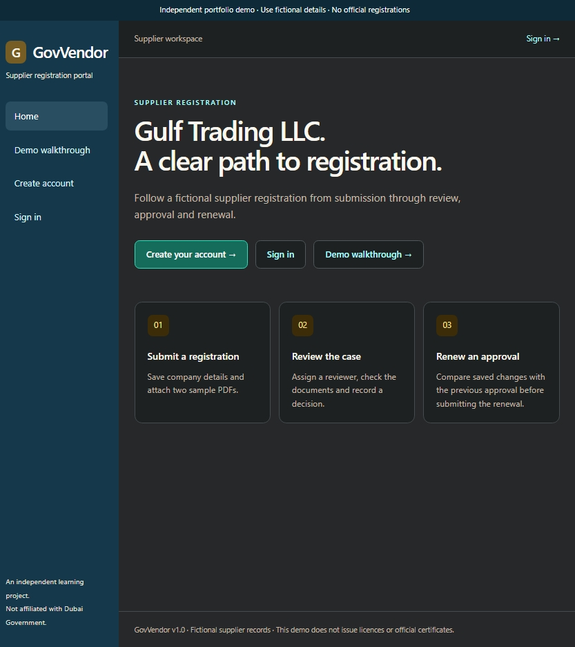
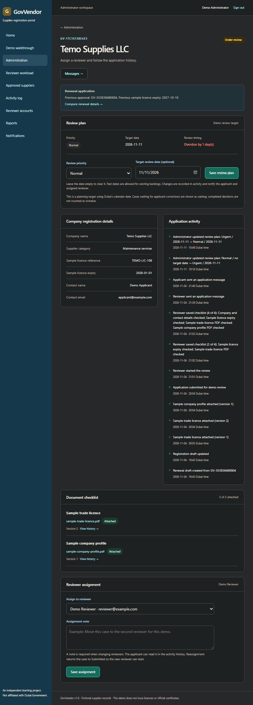
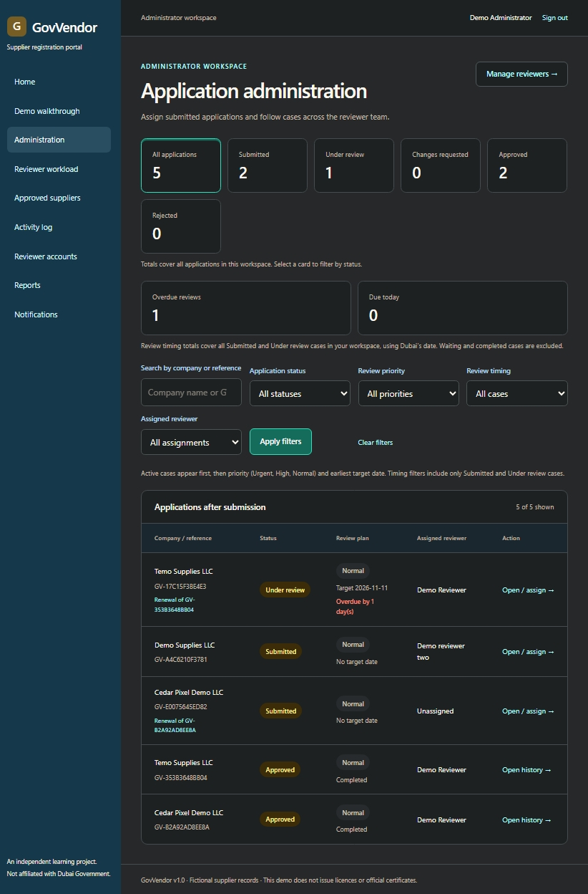
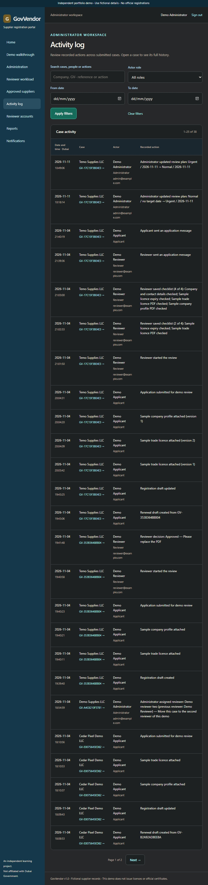
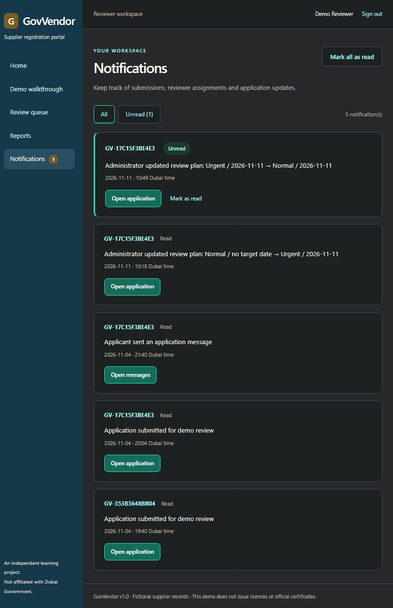

# GovVendor

GovVendor is a Flask and SQLite portfolio project that demonstrates supplier registration from a saved draft through review, approval, and renewal. It runs locally and uses fictional records and sample PDFs.

| Workspace | What you can demonstrate |
| --- | --- |
| Applicant | Save and submit a registration, upload and replace sample PDFs, message the reviewer, and compare a renewal with its previous approval. |
| Reviewer | Open assigned cases, complete a document checklist, request changes, and approve or reject an application. |
| Administrator | Assign reviewers, set target dates and priorities, check workloads, and search approved suppliers or recorded activity. |

The app includes in-app notifications, CSV reports, document version history, and a printable demo approval summary. Open **Demo walkthrough** from Home for a guided run through all three roles.

## Run locally

Extract the ZIP or clone the repository. Open a terminal in the folder containing `app.py`. This project was tested with Python 3.12.

**Windows PowerShell**

```powershell
py -3 -m venv .venv
.\.venv\Scripts\python.exe -m pip install -r requirements.txt
.\.venv\Scripts\python.exe app.py
```

**macOS or Linux**

```sh
python3 -m venv .venv
./.venv/bin/python -m pip install -r requirements.txt
./.venv/bin/python app.py
```

Open [http://127.0.0.1:5000](http://127.0.0.1:5000). Create a fictional applicant account in the app. For administrator and reviewer setup, see [ADMIN_GUIDE.md](ADMIN_GUIDE.md). The sample upload files are in `sample-documents/`.

## How it works

- `app.py` handles Flask routes, account permissions, and case transitions.
- `schema.sql` defines the SQLite records for users, applications, documents, reviews, and activity.
- `templates/` renders the workspaces with Jinja. `static/` provides the layout and styles.
- `tests/` covers application workflows, access boundaries, document history, reports, and renewals.

To run the automated tests on Windows:

```powershell
.\.venv\Scripts\python.exe -m unittest discover -s tests -v
```

Use `./.venv/bin/python` in place of `.\.venv\Scripts\python.exe` on macOS or Linux. Tests create temporary databases; the running app creates local data under `instance/`.

## Demo and documentation

- [START_HERE.md](START_HERE.md): Windows setup with sample registration fields.
- [DEMO_SCRIPT.md](DEMO_SCRIPT.md): a two-and-a-half-minute portfolio recording plan.
- [PROJECT_GUIDE.md](PROJECT_GUIDE.md): detailed workflows, implementation notes, and milestone history.

GovVendor is an independent demonstration. It has no government affiliation or live government integration and does not issue official registrations. The packaged project includes sample PDFs, but no local database, uploaded documents, or account credentials.

## App Preview





